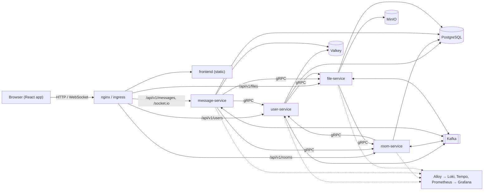
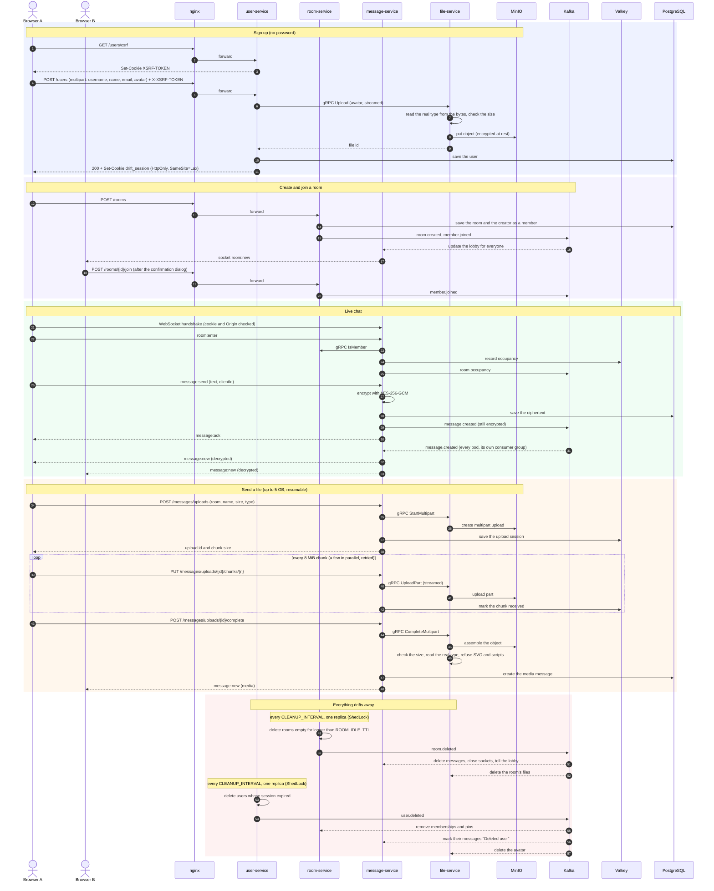
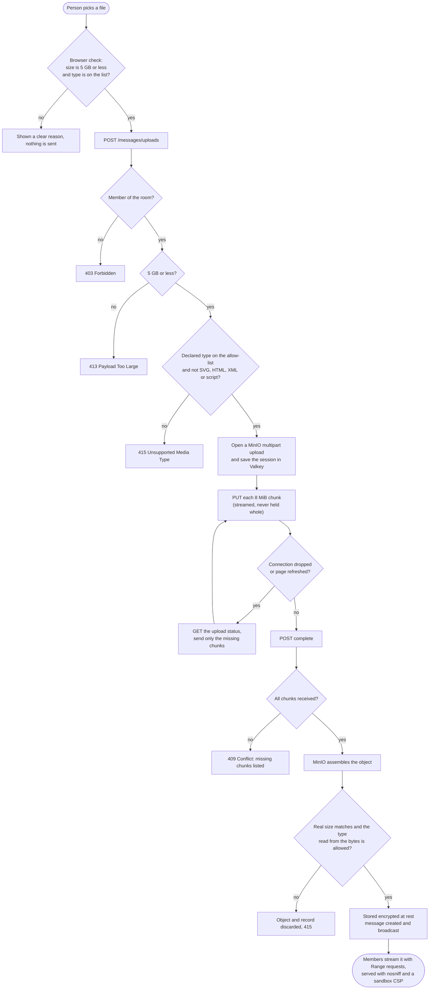
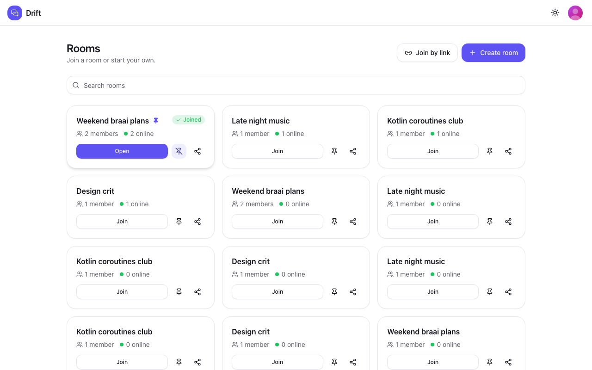
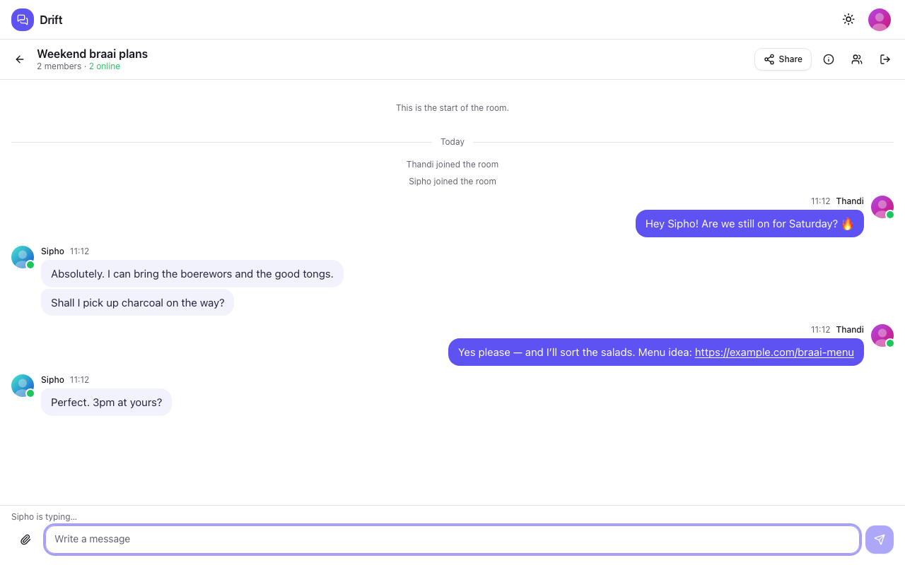
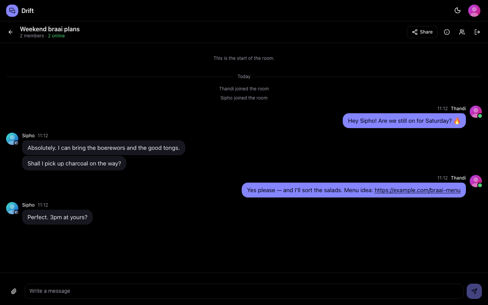

# Drift

> Drop in with a username, chat live, and let rooms drift away when everyone's gone.

## 🚀 Purpose

The goal of this system is to build a real-time chat platform with **no passwords and nothing that lingers**. People sign up with a username and an avatar, browse and join public rooms, and chat live with text, images, audio and video. A session lasts 24 hours, and a room that nobody has been inside for 24 hours deletes itself together with its messages and files.

The platform is event-driven: the services call each other over gRPC, publish facts to Kafka (`user.deleted`, `room.deleted`, `message.created`, …), and a Socket.IO server pushes everything to the browsers live. Messages are encrypted before they reach the database or Kafka, and large files travel in resumable chunks straight into MinIO.

It is also a reference for **Kotlin + Spring Boot microservices**, gRPC, Kafka, Socket.IO, Kubernetes and full observability. One command brings everything up and one command removes it.

## 🧩 Problem Statement

Most chat products are heavier than the moment they are used for:

- Sign-up walls (email, password, verification) stand between a person and a conversation
- Old rooms, accounts and uploads pile up forever, with no clean way to let them go
- Live updates (presence, typing, new rooms, new messages) are bolted on and fall out of sync across several servers
- Large uploads fail halfway and start again from zero
- Anything a user uploads can be an SVG or a script in disguise
- Chat text sits readable in the database and on the message bus

Building the sign-up → room → live message → upload → cleanup loop, correctly and observably, is a lot of infrastructure to recreate for every app.

## ✅ This project solves that by

- Letting anyone enter with a **username, a name, an email and an avatar**, with no password, and ending the session (and the account) after `SESSION_TTL`
- Keeping **every room public**: join with a confirmation, leave, rejoin, pin rooms to *your* list, search, and share a link `/r/<slug>`
- Pushing messages, typing, online dots, member lists and room counts over **Socket.IO**, with one Kafka consumer group per pod so every pod's sockets get every event
- Deleting idle rooms and expired users through **scheduled jobs guarded by ShedLock**, with Kafka events cascading the cleanup into messages, files and avatars
- Uploading files up to **5 GB** in 8 MiB chunks that **resume** after a dropped connection or a page refresh, never holding the whole file in memory
- Reading a file's real type from its **bytes**, allowing only common pictures, audio and video, and **always refusing SVG, HTML, XML and scripts**
- Encrypting message text with **AES-256-GCM** before it touches PostgreSQL or Kafka, and files at rest in MinIO

This design keeps the app ephemeral, private and observable.

## ⚙️ Stack

- **Backend:** Kotlin, Spring Boot 4.1, Java 25 (Amazon Corretto), virtual threads and coroutines. Four standalone Gradle projects, no Lombok
- **Service to service:** gRPC (grpc-kotlin) for calls, Kafka (KRaft) for events
- **Live chat:** Socket.IO v4 (netty-socketio) over WebSocket
- **Data:** PostgreSQL (one database per service) with Flyway, Valkey, MinIO
- **Frontend:** React 19, Vite, TypeScript, Tailwind CSS v4, shadcn/ui, React Router, TanStack Query, Zustand, React Hook Form + Zod
- **Edge and running it:** nginx, Docker Compose, Kubernetes (minikube) with Kustomize
- **Observability:** Micrometer, OpenTelemetry, Prometheus, Grafana, Loki, Tempo, Grafana Alloy
- **Quality:** ktlint, detekt, JUnit, MockK, Testcontainers, JaCoCo (80% or more), Vitest, React Testing Library

## 🗺️ Architecture Diagram

Everything from outside goes through nginx (or the ingress on Kubernetes). The services talk to each other over gRPC and publish events to Kafka.



| Service | Owns | Ports (HTTP / gRPC / management) |
|---|---|---|
| **user-service** | Accounts, the session cookie (JWT), presence, expiry of users | 8081 / 9081 / 8181 |
| **room-service** | Rooms, members, pins, share slugs, the idle-room countdown and cleanup | 8082 / 9082 / 8182 |
| **message-service** | Socket.IO server, message history, encryption, chunked uploads, typing, occupancy, live fan-out | 8083 (+ 8090 sockets) / n.a. / 8183 |
| **file-service** | Files in MinIO (avatars and room media), type sniffing, Range downloads | 8084 / 9084 / 8184 |

### Sequence diagram: a day in Drift

From sign-up to a message, a file, and the cleanup that finally removes everything.



### Flow diagram: what happens to an uploaded file



## ⭐ Key Features

- **Zero-friction entry:** username, name, email and avatar. No password
- **Rooms:** every room is visible to everyone. Join with a confirmation, leave, rejoin, pin, search, create, and share `/r/<slug>` (works even before you have signed up)
- **Live everything:** messages, typing, online dots, member lists, room counts and new rooms update without a refresh
- **Rich media:** clickable links, inline images with a full-screen viewer, audio and video players, and resumable uploads with progress and cancel
- **Ephemeral by design:** a session ends after `SESSION_TTL` (24 h) and the account goes with it. A room empty for `ROOM_IDLE_TTL` (24 h) is deleted with its messages and files
- **Private:** AES-256-GCM message encryption with key versions, server-side encryption in MinIO
- **Modern UI:** white with a violet accent and a true-black dark mode. Responsive and accessible
- **Observability:** six provisioned Grafana dashboards, JSON logs with trace ids in Loki, traces across HTTP, gRPC and Kafka in Tempo

### Allowed files

| Kind | Types |
|---|---|
| Pictures | JPEG, PNG, GIF, WebP, AVIF, BMP |
| Audio | MP3, OGG, WAV, WebM, M4A (MP4), AAC, FLAC |
| Video | MP4, WebM, OGG, MOV (QuickTime) |
| Size | **5 GB** per file (avatars: 5 MB) |
| Never accepted | SVG, HTML, XML, JavaScript, ZIP, executables. This is enforced in code even if someone adds them to `ALLOWED_MIME_TYPES` |

## 🖼️ Screenshots

| Lobby | Room (light) | Room (dark) |
| --- | --- | --- |
|  |  |  |

## 📊 Data

**PostgreSQL** (one database per service, created by the deploy script; every database also holds the `shedlock` table):

- `users_db` → `users` (account, avatar file id, session expiry)
- `rooms_db` → `rooms`, `room_members`, `room_pins` (slug, idle countdown, membership, per-user pins)
- `messages_db` → `messages` (encrypted text, key version, sender, media reference)
- `files_db` → `files` (owner, kind, room, sniffed type, size, object key)

**Kafka topics:** `user.deleted`, `user.updated`, `presence.changed`, `room.created`, `room.updated`, `room.deleted`, `member.joined`, `member.left`, `room.occupancy`, `message.created`

**Valkey:** room occupancy (sorted sets), typing state (hash plus pub/sub), upload sessions, presence, de-duplication keys

**MinIO buckets:** `drift-avatars`, `drift-media`

## 🔒 Security model

- **Session:** a signed JWT (HS256) in an HttpOnly, SameSite=Lax cookie `drift_session`. JavaScript never sees it. `Secure` is added when `COOKIE_SECURE=true`
- **CSRF:** every state-changing request carries `X-XSRF-TOKEN` matching the readable `XSRF-TOKEN` cookie (double submit). Missing or wrong means `403`
- **Sockets:** the handshake is refused unless the `Origin` is in `ALLOWED_ORIGINS` and the cookie holds a valid JWT
- **At rest:** message text is encrypted with AES-256-GCM (fresh nonce per message, stored key version) before PostgreSQL or Kafka. Files are encrypted in MinIO
- **Files:** the type comes from the bytes, never from the client. Room files are served only to room members, with `X-Content-Type-Options: nosniff` and `Content-Security-Policy: default-src 'none'; sandbox`
- **In transit:** the local stack is plain HTTP, WS and gRPC on a private network. Put the edge behind HTTPS and set `COOKIE_SECURE=true` for anything beyond your own machine
- **Trust boundary:** only nginx or the ingress is reachable from outside. The actuator ports are never published

## 🚀 Getting Started

### 📋 Prerequisites

- Docker and Docker Compose
- For Kubernetes locally: minikube and kubectl
- Amazon Corretto 25 (to run the backend tests; the Gradle Wrapper downloads Gradle itself)
- Node.js and Yarn (to run the frontend tests)
- **Memory:** running Compose **and** minikube together wants about **12 GB for Docker Desktop**. With less, run one half at a time

### 🔑 Logins, passwords and secrets

Every local username and password is **`admin-change-me`**, so it is easy to search for and replace.

| What | URL | Username | Password |
|---|---|---|---|
| App | http://localhost:8080 | sign up (no password) | |
| MinIO console | http://localhost:9001 | `admin-change-me` | `admin-change-me` |
| Grafana | http://localhost:3000 | none (anonymous) | |
| Prometheus | http://localhost:9090 | none | |
| PostgreSQL (inside the stack only) | `postgres:5432` | `admin-change-me` | `admin-change-me` |

On Kubernetes the app is at `http://drift.<minikube-ip>.nip.io`, Grafana at `http://grafana.<minikube-ip>.nip.io`, and the MinIO console is reached with `kubectl --context drift -n drift port-forward svc/minio 9001:9001`.

**Change all of these before using Drift anywhere but your own machine.** To find every place, run `grep -rn "admin-change-me" . --exclude-dir=node_modules --exclude-dir=build`.

| Value | Where it lives | Notes |
|---|---|---|
| `POSTGRES_USER` / `POSTGRES_PASSWORD` | `docker-compose.yml`, `deploy/k8s/infra/secret.yaml` (copied from `secret.example.yaml`) | Must match `DATABASE_USERNAME` / `DATABASE_PASSWORD` in all four `backend/<service>/.env` files |
| `MINIO_ROOT_USER` / `MINIO_ROOT_PASSWORD` | `docker-compose.yml`, `deploy/k8s/infra/secret.yaml` | Must match `MINIO_ACCESS_KEY` / `MINIO_SECRET_KEY` in `backend/file-service/.env` |
| `GRAFANA_ADMIN_USER` / `GRAFANA_ADMIN_PASSWORD` | `docker-compose.yml`, `deploy/k8s/observability/observability.yaml` | Grafana is anonymous locally; turn `GF_AUTH_ANONYMOUS_ENABLED` off for real use |
| `JWT_SECRET` | all four `backend/<service>/.env` | At least 32 bytes and **identical in every service**. Make one with `openssl rand -base64 48` |
| `MESSAGE_ENCRYPTION_KEY` | `backend/message-service/.env` | Base64 of exactly 32 bytes: `openssl rand -base64 32`. Losing it makes old messages unreadable |
| `MINIO_KMS_SECRET_KEY` | `docker-compose.yml`, `backend/file-service/.env` | Format `key-name:base64-of-32-bytes`: `echo "drift-key:$(openssl rand -base64 32)"` |
| `COOKIE_SECURE` | all four `.env` files | `false` locally (plain HTTP). Set `true` once you serve over HTTPS |
| `ALLOWED_ORIGINS` | `backend/message-service/.env` | The origin your users open, for example `https://chat.example.com` |

### 📝 Files you create (once)

The real config files are **not in git**, so a fresh clone does not have them. Only their templates are committed. `./scripts/deploy.sh` creates any missing file by copying its template and tells you which ones, so you can simply run it. To create them yourself first (for example to change a password before the first start):

```bash
cp backend/user-service/.env.example    backend/user-service/.env
cp backend/room-service/.env.example    backend/room-service/.env
cp backend/message-service/.env.example backend/message-service/.env
cp backend/file-service/.env.example    backend/file-service/.env
cp deploy/k8s/infra/secret.example.yaml deploy/k8s/infra/secret.yaml
cp frontend/drift-chat/.env.example     frontend/drift-chat/.env
```

| File to create | Copy it from | Needed for | Edit it when |
|---|---|---|---|
| `backend/<service>/.env` (four of them) | `backend/<service>/.env.example` | Compose and Kubernetes (the k8s ConfigMaps and Secrets are generated from these) | you change a password, `JWT_SECRET`, `MESSAGE_ENCRYPTION_KEY`, limits or TTLs |
| `deploy/k8s/infra/secret.yaml` | `deploy/k8s/infra/secret.example.yaml` | Kubernetes only (Postgres and MinIO logins, MinIO encryption key) | you change the database or MinIO login |
| `frontend/drift-chat/.env` | `frontend/drift-chat/.env.example` | Optional: only for `yarn dev` or to change the upload limit shown in the browser | rarely |

All the real files are git-ignored, so your edits never get committed. Edit the copies, never the `.example` files. Keep the matching values in step across files: the database login in `docker-compose.yml`, `secret.yaml` and every service `.env`; the MinIO login in `docker-compose.yml`, `secret.yaml` and `backend/file-service/.env`; and the same `JWT_SECRET` in all four service `.env` files.

### ⚙️ Environment

Only the examples are in git: `backend/<service>/.env.example` for each service, `frontend/drift-chat/.env.example`, and `deploy/k8s/infra/secret.example.yaml` for the Kubernetes secrets. The real `.env` files and `deploy/k8s/infra/secret.yaml` are git-ignored and **do not exist in a fresh clone**: `deploy.sh` creates any that are missing by copying the example, and tells you. Edit the copies (not the examples) for your own values. There is no root `.env`: the infrastructure defaults live in `docker-compose.yml` and any of them can be overridden by an environment variable, for example `EDGE_PORT=8081 ./scripts/deploy.sh`.

```
SERVICE_NAME=message-service
HTTP_PORT=8083
GRPC_PORT=9083
MANAGEMENT_PORT=8183
DATABASE_URL=jdbc:postgresql://localhost:5432/messages_db
DATABASE_USERNAME=admin-change-me
DATABASE_PASSWORD=admin-change-me
KAFKA_BOOTSTRAP_SERVERS=localhost:9092
VALKEY_HOST=localhost
JWT_SECRET=change-me-at-least-32-bytes-long-secret
COOKIE_SECURE=false
ALLOWED_ORIGINS=http://localhost:8080
MESSAGE_ENCRYPTION_KEY=Y2hhbmdlLW1lLWNoYW5nZS1tZS1jaGFuZ2UtbWUtMzI=
MAX_FILE_SIZE=5GB
UPLOAD_CHUNK_SIZE=8MB
```

| Variable | Where | Meaning |
|---|---|---|
| `SESSION_TTL` | user-service | How long a session and its account last (`24h`) |
| `ROOM_IDLE_TTL` | room-service | How long an empty room lives (`24h`) |
| `CLEANUP_INTERVAL` | user-, room-service | How often the cleanup jobs run (`5m`) |
| `MAX_FILE_SIZE`, `UPLOAD_CHUNK_SIZE` | message-, file-service | File limit (`5GB`) and chunk size (`8MB`, at least 5 MB) |
| `ALLOWED_MIME_TYPES` | message-, file-service | Comma-separated allow-list (SVG and scripts are refused regardless) |
| `EDGE_PORT` | Compose / scripts | Port the app is served on (`8080`) |

Durations use Spring's format (`24h`, `5m`, `30s`).

### Steps

**Step 1: clone the repo and run everything from the repo root**

```bash
git clone <your-repo-url> drift-chat
cd drift-chat
```

**Step 2: make the scripts executable (macOS / Linux)**

```bash
chmod +x scripts/deploy.sh scripts/status.sh scripts/teardown.sh
```

**Step 3: start the stack**

```bash
./scripts/deploy.sh              # tests, images, Docker Compose AND minikube (Kubernetes)
./scripts/deploy.sh compose-up   # tests, images, Docker Compose only
./scripts/deploy.sh k8s-up       # tests, images, minikube only
./scripts/status.sh              # what is running, health, and the URLs
```

Options are environment variables:

```bash
SKIP_TESTS=true ./scripts/deploy.sh          # skip the tests and go straight to building
NO_OPEN=true ./scripts/deploy.sh             # do not open the browser at the end
EDGE_PORT=8081 ./scripts/deploy.sh           # the app on another port (and: EDGE_PORT=8081 ./scripts/status.sh)
MINIKUBE_MEMORY=8192 ./scripts/deploy.sh k8s-up   # memory for minikube in MB (default: what Docker has left, up to 8192)
```

What `deploy.sh` does, in order: checks your tools, makes sure every service `.env` exists, runs every service's `./gradlew check` and the frontend lint, type-check and tests (it stops if anything fails), builds the five images, starts the infrastructure, **creates the databases, Kafka topics and MinIO buckets**, starts everything else, starts (or reuses) the minikube `drift` profile, loads the images, generates each service's ConfigMap and Secret from its `.env`, applies the manifests, waits for the rollouts, prints the URLs and opens the app, Grafana and the MinIO console.

On macOS with the Docker driver the minikube IP is not reachable from your machine. Run this in another terminal (it asks for your password) so the `nip.io` addresses work:

```bash
minikube -p drift tunnel
```

**Step 4: tear down (stops containers first, then removes everything)**

```bash
./scripts/teardown.sh            # Compose + minikube + images + build output (asks y/N)
./scripts/teardown.sh compose    # Compose only
./scripts/teardown.sh k8s        # minikube only
./scripts/teardown.sh all --yes  # no question
```

Teardown removes the Compose stack with its volumes (all chat data), the minikube profile, the `drift/*` images, the Gradle daemons and the build output. Any `.env` files and `secret.yaml` you edited are kept.

### ▶️ Try it from the command line

```bash
JAR=$(mktemp)
curl -s -c $JAR http://localhost:8080/api/v1/users/csrf -o /dev/null
TOKEN=$(grep XSRF-TOKEN $JAR | awk '{print $7}')

curl -s -b $JAR -c $JAR -H "X-XSRF-TOKEN: $TOKEN" \
  -F username=sipho -F name=Sipho -F email=sipho@example.com \
  -F "avatar=@avatar.png;type=image/png" \
  http://localhost:8080/api/v1/users

TOKEN=$(grep XSRF-TOKEN $JAR | awk '{print $7}')
curl -s -b $JAR -H "X-XSRF-TOKEN: $TOKEN" -H "Content-Type: application/json" \
  -d '{"name":"General"}' http://localhost:8080/api/v1/rooms
```

Every state-changing request needs the `XSRF-TOKEN` cookie value sent back in the `X-XSRF-TOKEN` header.

## 🛠️ Tests

```bash
cd backend/user-service && ./gradlew check      # ktlint, detekt, unit + integration tests, JaCoCo 80% or more
cd backend/room-service && ./gradlew check
cd backend/message-service && ./gradlew check
cd backend/file-service && ./gradlew check

cd frontend/drift-chat
yarn lint
yarn tsc -b
yarn test                                       # Vitest + React Testing Library
```

The integration tests start real PostgreSQL, Kafka, Valkey and MinIO with Testcontainers, so Docker must be running. The message-service one drives a real Socket.IO handshake over a WebSocket.

## 📈 Observability

Grafana ships six provisioned dashboards in the folder *Drift*: **overview** (request rate, errors, p50/p95/p99), **real-time** (active sockets, occupied rooms, messages per second), **storage** (uploads, sizes, MinIO usage), **cleanup** (rooms deleted, users expired), **Kafka** (consumer lag) and **JVM** (heap, GC, threads).

- **Metrics:** each service exposes `/actuator/prometheus` on its management port and Prometheus scrapes it
- **Logs:** one JSON object per line with trace and span ids; Alloy ships them to Loki. Try `{service="message-service"}` in Grafana → Explore
- **Traces:** OpenTelemetry traces across HTTP, gRPC and Kafka go through Alloy to Tempo

## 🗂️ Folder structure

```
backend/
  proto/                 shared .proto files
  user-service/          standalone Gradle projects with the same layout:
  room-service/            src/main/kotlin/com/drift/<service>/{common,config,models,interfaces,dto,
  message-service/                                             exceptions,controller,repository,service,utils}
  file-service/
frontend/drift-chat/     React app (src/{api,socket,components,features,pages,hooks,lib,stores,styles})
deploy/
  nginx/                 edge nginx config (Docker Compose)
  observability/         prometheus, loki, tempo, alloy, grafana (+ provisioned dashboards)
  k8s/                   Kustomize manifests for minikube
scripts/                 deploy.sh, status.sh, teardown.sh
docker-compose.yml       the local stack
*.env.example, secret.example.yaml   the templates for every .env and for the Kubernetes secrets
```
