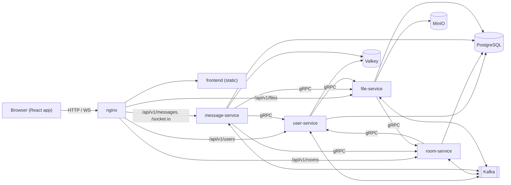
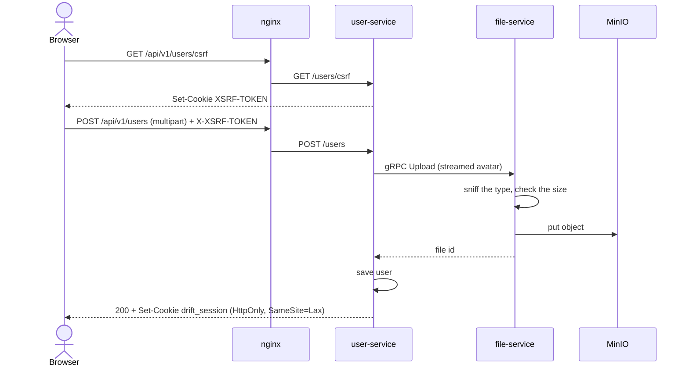
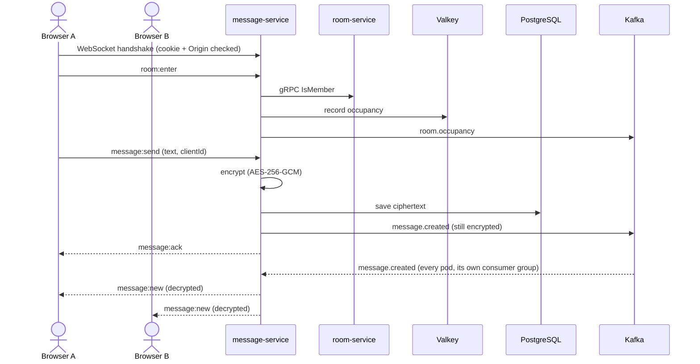
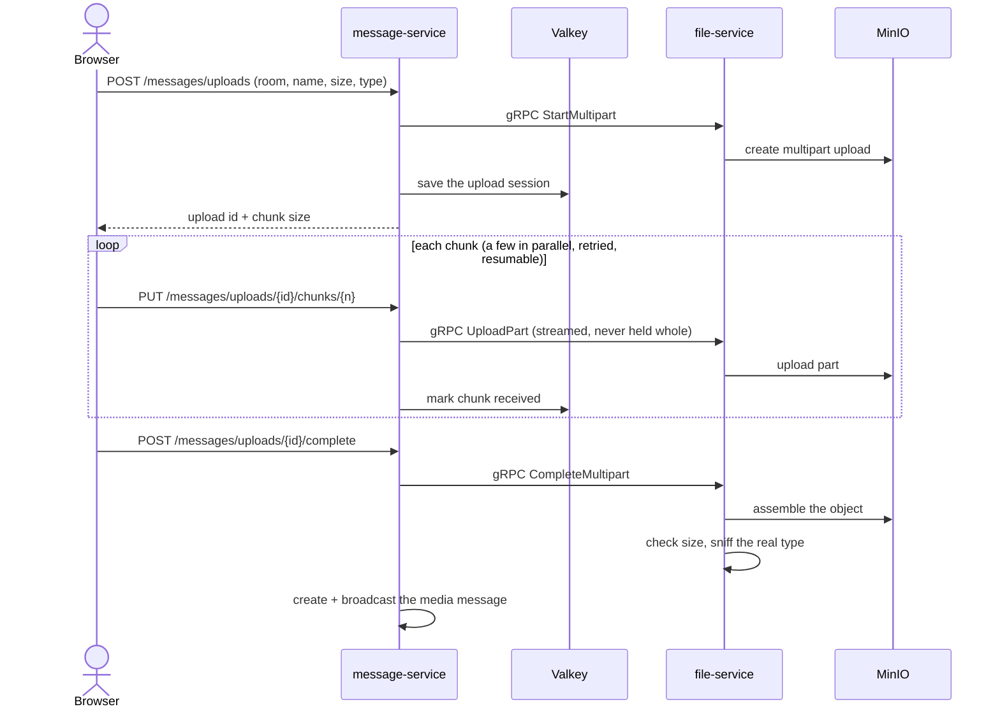
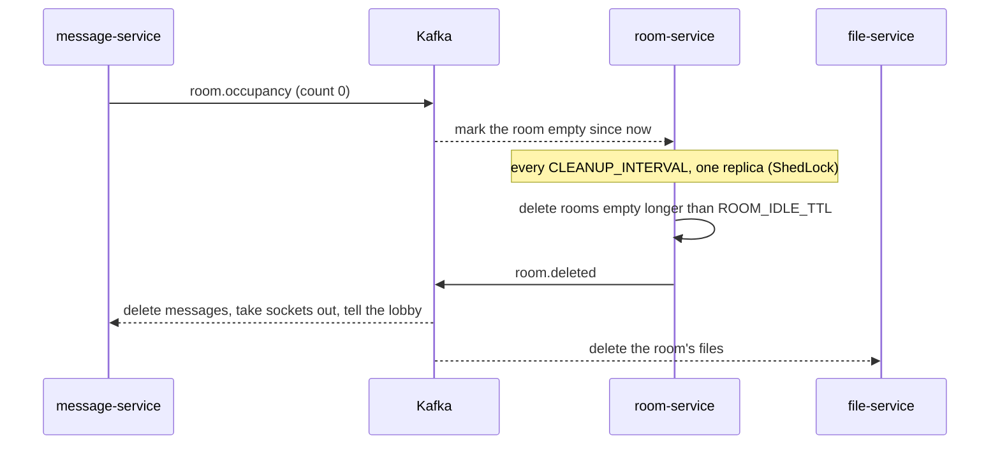
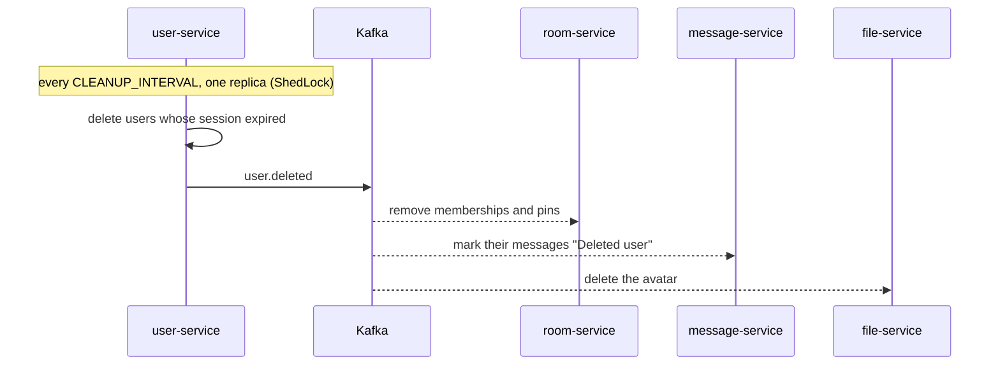

# Drift

> Drop in with a username, chat live, and let rooms drift away when everyone's gone.

Drift is a real-time chat platform with no passwords. You sign up with a username and an avatar, browse and join public
rooms, and chat live with text, images, audio and video. Sessions last 24 hours and rooms that nobody has been inside for
24 hours delete themselves, so nothing lingers.

It is also a portfolio-grade reference for **Kotlin + Spring Boot microservices**, gRPC, Kafka, Socket.IO, Kubernetes and
full observability. One command (`scripts/deploy.sh`) brings everything up, and one command (`scripts/teardown.sh`)
removes it.

<!-- Add a screenshot or GIF of the app in use here: docs/screenshot.png -->
> _Screenshot / GIF: run the app (see below) and add one here._

## Features

- **Zero-friction entry.** A username, a name, an email and an avatar. No password.
- **Rooms.** Every room is visible to everyone. Join (with a confirmation), leave, rejoin, pin rooms to the top of *your*
  list, search, create rooms, and share a link `/r/<slug>` that works even if you aren't signed up yet.
- **Live everything.** Messages, typing indicators, online/offline dots, member lists, room counts and new rooms all update
  without a refresh.
- **Rich media.** Text with clickable links, inline images (full-screen viewer), audio and video players. Files up to
  **1 GB**, uploaded in resumable chunks with progress and cancel: a dropped connection or a page refresh continues where it
  stopped.
- **Ephemeral by design.** A session ends after `SESSION_TTL` (24 h) and the account goes with it: memberships, pins and
  avatar are deleted and old messages show as "Deleted user". A room empty for `ROOM_IDLE_TTL` (24 h) is deleted with all
  its messages and files.
- **Private.** Messages are encrypted with AES-256-GCM before they touch the database or Kafka, and files are encrypted at
  rest in MinIO.
- **Modern UI.** White with a violet accent, and a true-black dark mode with the same accent. Responsive, accessible.

## Tech stack

| | |
|---|---|
| Backend | Kotlin, **Spring Boot 4.1**, Java 25 (Amazon Corretto), virtual threads, coroutines. Four standalone Gradle projects, no Lombok |
| Talking to each other | **gRPC** (grpc-kotlin) for calls, **Kafka** (KRaft) for events |
| Live chat | **Socket.IO v4** (netty-socketio) over WebSocket |
| Data | PostgreSQL (one database per service) with Flyway, Valkey, MinIO |
| Frontend | React 19, Vite, TypeScript, Tailwind CSS v4, shadcn/ui, React Router, TanStack Query, Zustand, React Hook Form + Zod, Sonner |
| Edge & running it | nginx, Docker, Docker Compose, Kubernetes (minikube) with Kustomize |
| Observability | Micrometer, OpenTelemetry, Prometheus, Grafana, Loki, Tempo, Grafana Alloy |
| Quality | ktlint, detekt, JUnit, MockK, Testcontainers, JaCoCo (≥ 80%), Vitest, React Testing Library |

## Architecture

Everything from outside goes through nginx. The services talk to each other over gRPC and publish events to Kafka.



### Sign up



### Entering a room and sending a message



### Sending a file (up to 1 GB)



### Room idle deletion



### User session expiry



## Services

| Service | Owns | Ports (HTTP / gRPC / management) |
|---|---|---|
| **user-service** | Accounts, sessions (the JWT cookie), presence (online/offline), expiry of users | 8081 / 9081 / 8181 |
| **room-service** | Rooms, members, pins, share slugs, the idle-room countdown and cleanup | 8082 / 9082 / 8182 |
| **message-service** | The Socket.IO server, message history, encryption, chunked uploads, typing, occupancy, live fan-out | 8083 (+ 8090 sockets) / – / 8183 |
| **file-service** | Files in MinIO (avatars and room media), type sniffing, Range downloads | 8084 / 9084 / 8184 |

Each service is a standalone Gradle project with its own Gradle Wrapper, Dockerfile, `.env`, database and tests.

## Security model

- **Session.** A signed JWT (HS256) in an **HttpOnly, SameSite=Lax** cookie called `drift_session`. JavaScript never sees it
  (no `localStorage`, no `Authorization` header). It expires with the session and the account is deleted. `Secure` is set
  when `COOKIE_SECURE=true` (turn it on behind HTTPS).
- **CSRF.** The browser sends the cookie by itself, so every state-changing request also carries `X-XSRF-TOKEN`, matching
  the readable `XSRF-TOKEN` cookie (double submit). A missing or wrong token is a `403`.
- **Sockets.** The handshake is refused unless the `Origin` is on the allow-list (`ALLOWED_ORIGINS`) and the cookie holds a
  valid JWT; the socket is closed when that JWT expires.
- **Encrypted at rest.** Message text is encrypted with **AES-256-GCM** (a fresh nonce per message, a stored `key_version` so
  keys can be rotated) *before* it reaches PostgreSQL or Kafka. The key is `MESSAGE_ENCRYPTION_KEY`, held in the service's
  `.env` or a Kubernetes Secret. Files are encrypted in MinIO with server-side encryption (`MINIO_KMS_SECRET_KEY`).
- **Files.** The type is sniffed from the bytes (never trusted from the client) and checked against an allow-list. Room files
  are only served to members of that room.
- **Encrypted in transit.** *Not in the local stack.* By decision there are no certificates: everything is plain HTTP, WS and
  gRPC on a private network. Put the edge behind HTTPS and set `COOKIE_SECURE=true` for anything beyond your own machine.
- **Trust boundary.** Services trust each other on the private network. Only nginx / the ingress is reachable from outside;
  the management (actuator) ports are never published.

## Prerequisites

| Tool | Version |
|---|---|
| Docker + Docker Compose | latest stable |
| minikube and kubectl | latest stable (only for the Kubernetes half) |
| JDK | Amazon Corretto 25 (only to run the tests; the Gradle Wrapper fetches Gradle itself) |
| Node.js and Yarn | current LTS / latest stable (only to run the frontend tests) |

**Machine resources.** Four JVM services run in each stack, so running Docker Compose **and** minikube together wants roughly
**12 GB of memory given to Docker Desktop**. With less, `deploy.sh` warns and sizes minikube to what Docker has; you can run
one half at a time (`--skip-k8s` or `--skip-compose`).

## Configuration

- **Each service has exactly one `.env` and one `.env.example`** in its own folder (`backend/<service>/`), and the repository
  root has one for the infrastructure (Postgres, MinIO and Grafana credentials). `.env` is git-ignored; `.env.example` holds
  values that work out of the box. `deploy.sh` copies any missing `.env` from its example and tells you.
- Every setting is read from environment variables and bound to a validated configuration class; a bad value stops the
  service at startup with a clear message.
- Durations use Spring's format (`24h`, `5m`, `30s`).

Key variables:

| Variable | Where | Meaning |
|---|---|---|
| `SESSION_TTL` | user-service | How long a session (and account) lasts. Default `24h` |
| `ROOM_IDLE_TTL` | room-service | How long an empty room lives. Default `24h` |
| `CLEANUP_INTERVAL` | user-, room-service | How often the cleanup jobs run. Default `5m` |
| `MAX_FILE_SIZE`, `UPLOAD_CHUNK_SIZE` | message-, file-service | File limit (`1GB`) and chunk size (`8MB`, at least 5 MB) |
| `MESSAGE_ENCRYPTION_KEY` | message-service | Base64 of 32 bytes: `openssl rand -base64 32` |
| `JWT_SECRET` | every service | Must be identical everywhere, at least 32 bytes |
| `ALLOWED_ORIGINS` | message-service | Origins allowed to open a socket |
| `COOKIE_SECURE` | every service | `false` for the plain-HTTP local stack |

If you change a credential that appears in two places (for example the database password), change both: they are marked as
twins in `.env.example`.

## Deploy, check, tear down

Only three scripts, all safe to run more than once and all stopping at the first failure:

```bash
scripts/deploy.sh      # everything: tests, images, Docker Compose, minikube
scripts/status.sh      # what is running, health, and the URLs
scripts/teardown.sh    # remove it all (asks first; --yes skips the question)
```

**`deploy.sh`** does, in order: check your tools (and print install hints) → make sure every `.env` exists → run every
service's `./gradlew check` and the frontend lint, type-check and tests (stops if anything fails) → build the five images →
start the infrastructure with Docker Compose, **create the databases, Kafka topics and MinIO buckets**, then start
everything else → start (or reuse) the minikube `drift` profile with the `ingress`, `metrics-server` and `dashboard` addons →
load the images into minikube → generate each service's ConfigMap and Secret from its `.env` → apply the Kubernetes
manifests and wait for the rollouts → print all URLs → open the app, Grafana and the minikube dashboard.

Options: `--skip-tests`, `--skip-compose`, `--skip-k8s`, `--no-open`.

**`teardown.sh`** removes the Compose stack with its volumes, the Kubernetes namespaces, the minikube profile, the `drift/*`
images and containers, the Gradle daemons and all build output. Your `.env` files are kept.

## URLs and local credentials

| | URL | Login |
|---|---|---|
| **App (Compose)** | http://localhost:8080 | sign up |
| Grafana (Compose) | http://localhost:3000 | `admin` / `admin-change-me` |
| Prometheus (Compose) | http://localhost:9090 | |
| MinIO console (Compose) | http://localhost:9001 | `minioadmin` / `change-me` |
| **App (Kubernetes)** | `http://drift.<minikube-ip>.nip.io` | sign up |
| Grafana (Kubernetes) | `http://grafana.<minikube-ip>.nip.io` | `admin` / `admin-change-me` |
| minikube dashboard | `minikube -p drift dashboard` | |

`nip.io` names resolve to the IP inside them, so no hosts-file edits are needed. **On macOS with the Docker driver** the
minikube IP is not reachable from your machine: run `minikube -p drift tunnel` in another terminal first. All credentials
above are local-development defaults from the `.env.example` files.

## Running the tests

```bash
cd backend/user-service && ./gradlew check      # ktlint, detekt, unit + integration tests, JaCoCo ≥ 80%
cd backend/user-service && ./gradlew test       # tests only
# same for room-service, message-service and file-service
cd frontend/drift-chat && yarn test             # Vitest + React Testing Library  (yarn lint, yarn tsc -b as well)
```

The integration tests start real PostgreSQL, Kafka, Valkey and MinIO with Testcontainers, so Docker must be running. The
message-service one drives a **real Socket.IO handshake over a WebSocket**.

## Observability

Grafana ships with six provisioned dashboards (folder *Drift*): **overview** (request rate, errors, p50/p95/p99 per
service), **real-time** (active sockets, rooms occupied, messages per second, fan-out latency), **storage** (uploads per
minute, sizes, MinIO usage), **cleanup** (rooms deleted, users expired, events consumed), **Kafka** (consumer lag) and
**JVM** (heap, GC, threads).

- **Metrics:** every service exposes `/actuator/prometheus` on its management port; Prometheus scrapes it.
- **Logs:** every service logs one JSON object per line (Spring Boot structured logging, with trace and span ids). Grafana
  Alloy ships container logs to Loki. In Grafana → *Explore* → Loki, try `{service="message-service"}`.
- **Traces:** services export OpenTelemetry traces (HTTP, gRPC, Kafka) through Alloy to Tempo. A log line with a trace id
  links straight to its trace, and a span links back to its logs.

## Folder structure

```
backend/
  proto/                 shared .proto files (a plain folder, not a Gradle project)
  user-service/          standalone Gradle projects, all with the same layout:
  room-service/            src/main/kotlin/com/drift/<service>/{common,config,models,interfaces,dto,exceptions,
  message-service/                                             controller,repository,service,utils[,socket]}
  file-service/
frontend/drift-chat/     React app (src/{api,socket,components,features,pages,hooks,lib,stores,styles})
deploy/
  nginx/                 edge nginx config (Docker Compose)
  observability/         prometheus, loki, tempo, alloy, grafana (+ provisioned dashboards)
  k8s/                   Kustomize manifests for minikube
scripts/                 deploy.sh, status.sh, teardown.sh
docker-compose.yml       the local stack (built from the repository root)
.env.example             infrastructure credentials for Compose
.dockerignore
spec.md                  the full specification and build checklist
```

## Troubleshooting

- **A service keeps restarting right after `docker compose up`.** Its database doesn't exist yet. `deploy.sh` creates them
  before starting the services; if you start Compose by hand, run the infrastructure first, create the databases, then start
  the rest (see `compose_setup` in `scripts/deploy.sh`).
- **Kubernetes step runs out of memory / pods `Pending` or `OOMKilled`.** Docker Desktop has less memory than needed. Raise it
  in *Settings → Resources*, or set `MINIKUBE_MEMORY` (in MB), or run one half at a time.
- **The `nip.io` addresses don't load on macOS.** Run `minikube -p drift tunnel` in a separate terminal (it may ask for your
  password).
- **`ImagePullBackOff` in Kubernetes.** The images are loaded into minikube by `deploy.sh`; if you rebuilt them, run
  `minikube -p drift image load drift/<service>:local` again and restart the deployment.
- **Docker can't pull `minio/minio`.** MinIO no longer publishes an official image. The stack uses `chainguard/minio` pinned
  by digest; nothing to do.
- **Gradle daemon eats memory.** The daemon is capped at 2 GB in each `gradle.properties`. `scripts/teardown.sh` (or
  `./gradlew --stop` in a service folder) stops it.
- **JDK version errors.** The services need JDK 25 (Amazon Corretto); Gradle uses a matching toolchain if it can find one.
- **`403` on every POST from a script.** Send the `XSRF-TOKEN` cookie back in the `X-XSRF-TOKEN` header after calling
  `GET /api/v1/users/csrf`.
- **Sockets refused from another origin.** Add it to `ALLOWED_ORIGINS` in `backend/message-service/.env`.

## Future ideas

- HTTPS at the edge with a real certificate, and `COOKIE_SECURE=true`.
- Direct messages, message reactions and edits.
- Replay of missed messages after a long disconnect, unread counters.
- Video transcoding so every browser can play every upload.
- JDBC spans in traces, alerting rules in Prometheus.
- A small integration test that runs the whole Compose stack in CI.

## Licence

No licence has been chosen yet. Until one is added, all rights are reserved by the author.
